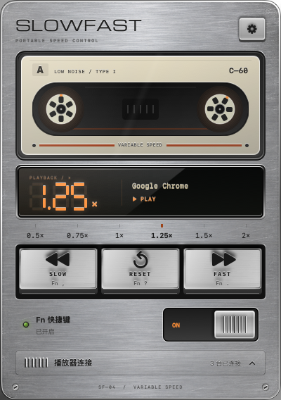

# SlowFast

一台放在 Mac 菜单栏里的复古磁带机，用 Fn 快捷键控制视频倍速。

**macOS 13+ · Apple Silicon / Intel · 本机运行 · 无需账号**

[下载最新版](https://github.com/1anzii/SlowFast/releases/latest) · [更新记录](CHANGELOG.md) · [使用说明](Resources/使用说明.html) · [开发文档](docs/DEVELOPMENT.md)



## 使用

1. 下载 Release 中的 DMG，将 **SlowFast.app** 拖入 **Applications**，从「应用程序」启动。
2. 点击菜单栏图标，在提示下开启辅助功能权限。打开底部「播放器连接」检查或修复连接。
3. 回到浏览器或播放器，播放视频，再使用快捷键。

| 快捷键 | 面板按键 | 作用 |
| --- | --- | --- |
| Fn + , | SLOW | 减慢一档 |
| Fn + . | FAST | 加快一档 |
| Fn + Shift + /（Fn + ?）或 Fn + / | RESET | 恢复 1× |

档位：**0.5 / 0.75 / 1 / 1.25 / 1.5 / 2×**，上下限不循环。某些第三方键盘不会向 macOS 报告 Fn，仍可使用面板按钮。

磁带随真实倍速转动，暂停时停转。READY 表示等待视频，OFF 表示 Fn 开关关闭，CHECK 表示需要检查权限或连接。连接列表默认收起；右上角打开独立、可拖动的设置窗口。面板收起后停止状态轮询与动画，遵循系统「减少动态效果」。

## 支持范围

| 播放位置 | 接入方式与限制 |
| --- | --- |
| Chrome、Safari | 当前标签页的 HTML5 视频；需要系统自动化权限和浏览器「允许 Apple 事件中的 JavaScript」 |
| Edge、Brave、Vivaldi、Arc | 同类 Chromium 接口；提供适配，未逐一实机验证 |
| QuickTime Player | 播放本地视频后调速；不会通过调速自动开始播放 |
| IINA / mpv | 本机 Unix socket；可配置接口，建议单窗口，第三方版本仍需实测 |
| VLC | 仅限 127.0.0.1 的 HTTP 接口，密码保存在钥匙串与 VLC 配置 |
| Chromium 跨站嵌入视频 | 可选配套扩展，安装说明见 [扩展文档](BrowserExtension/README.md) |

控制目标是**前台应用**。不承诺任意 App、直播、DRM、自绘播放器和网站锁定倍速的视频均可调速；Safari 跨域 iframe 不在当前覆盖范围。Chrome、Safari、QuickTime 已在开发机通过实体 Fn 快捷键验证；IINA / mpv / VLC 已通过协议模拟，不等于每个第三方版本均已实测。

## 权限与安装提示

当前分享包为 **ad-hoc 临时签名，未经过 Apple 公证**。确认来自可信来源后，按 macOS 提示在「系统设置 → 隐私与安全性」选择「仍要打开」。无需关闭系统保护。

每台 Mac 必须由本人授予辅助功能、自动化和相关浏览器权限；安装包不能携带他人的授权。升级临时签名版本后，如果辅助功能开关已开启但快捷键仍失效，请移除旧 SlowFast，再添加 `/Applications/SlowFast.app`。

浏览器连接修复会先说明脚本控制权限；系统身份验证和浏览器安全确认仍须由本人完成。本地播放器配置会在确认后备份设置并请求正常重启。

## 开发与验证

没有第三方 Swift 运行时依赖。安装 Xcode Command Line Tools 后：

```sh
bash scripts/build.sh
bash scripts/package.sh
python3 scripts/export-source.py
```

测试、架构、资源来源、限制与发布方式见 [开发文档](docs/DEVELOPMENT.md)、[验证记录](docs/VALIDATION.md) 和 [发布指南](PUBLISHING.md)。

## 隐私与许可

不上传视频、网页或按键，不记录普通键入内容；操作记录只保留本次运行最近 12 次调速结果。没有统计分析、账号或自动登录启动功能。

[GPL-3.0-only](LICENSE) · © 2026 1anzii。字体保留 SIL OFL 1.1，详细资源来源见 [第三方声明](THIRD_PARTY_NOTICES.md)。
